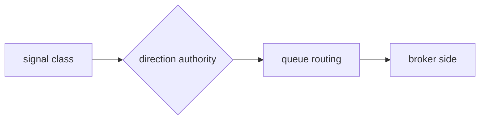

# Agent Handoff Rule — WRITE WHEN IT MATTERS

> **2026-09-11 — two corrections to this rule, both from measured failures.**
>
> 1. **`applyTo` was `nest/src/**, src/pages/**, ...` — it did NOT include `docs/**`.** So this rule
>    never fired while an agent was editing documentation, and handoffs were written to the wrong
>    directory. **An instruction that does not fire is indistinguishable from one that does not
>    exist.** It is now `"**"` because a handoff is written about work that spans any file type.
> 2. **Handoffs do NOT live in the repo.** The canonical location is the central docs store,
>    **`G:\My Drive\Project Management\Live\Trading-Command-Suite-Documentation\handoff\`** —
>    outside the app package, which becomes public. `.github/handoffs/` was removed 2026-09-11 and
>    `scripts/validate-agent-docs.cjs` still **fails the build** if it reappears.

Write a handoff file to **`G:\My Drive\Project Management\Live\Trading-Command-Suite-Documentation\handoff\`** BEFORE calling `task_complete` **only** when the change is one of:

1. **Closing a GitHub issue** — work that resolves an issue gets a handoff so the Librarian records it in the QA page, Capability Map, and Architecture Framework.
2. **Pipeline / behaviour / capability change** — a change that alters a pipeline's data flow or behaviour: new or changed API endpoints, Prisma schema changes, scoring/gating/trading/automation logic, provider adapters, or data contracts.
3. **New feature** — a genuinely new capability the Capability Map or Architecture Framework should track.

**Skip the handoff** for cosmetic-only work: visual styling, layout, copy/label tweaks, badge/theme adjustments, and trivial refactors with no behavioural change.

Rule of thumb: if the change would not belong on the Capability Map or Architecture Framework, it does not need a handoff.

## ✅ TWO SHAPES — decide which BEFORE you start writing

> **Added 2026-09-23, from measurement.** 206 handoffs, 1.29 MB, median **6.1 KB (~1,556 tokens)**.
> **62% land in one 4–8 KB band and none of 86 was under 2 KB** — the signature of a template
> setting the length rather than the change (`bugfix` averaged 4.6 KB against `feature` at 6.3 KB).
> The cause was two clauses fighting: *"skip it if it would not belong on the Capability Map"*
> against *"every handoff MUST carry all three entries"*. **Once you decided to write one, the
> second clause forced a full write-up — so a borderline bugfix could only skip it or pad it.**
> This section gives it a third option.

| | **Full handoff** | **Note** |
|---|---|---|
| **Use when** | a feature, a trackable capability, or any change to data flow / ordering / a contract / a boundary | a bugfix, small refactor, test or docs change with **no shape change** |
| **Sections** | frontmatter + What Changed + Files + Diagram + all three page entries | frontmatter + What Changed + Files + **QA Test Entry only** |
| **Size** | aim under 8 KB | aim under 2 KB |

⚠️ **The QA entry is the one thing a Note keeps**, and it is not ceremony: a bugfix with no
reproducible procedure is one nobody can re-verify. It is also the cheapest section — two lines.

## ⚠️ Retention — GitHub Issues are the durable record (2026-09-13)

A handoff is **working material**, not a permanent local document. It carries reasoning from the
agent that did the work to the Librarian that records it.

- The **durable, searchable** record of *why* is the **closed GitHub issue** plus the docs the
  Librarian writes (QA page, Capability Map, Architecture Framework). Local files are **not**
  required long-term.
- Handoffs therefore live in the **central docs store**, never in the app package — they are **not**
  retained in the repo.
- **Never delete a handoff before it has been summarised.** That is the one rule that still matters;
  once recorded, the source may be archived in the central store.

⚠️ The 2026-09-11 loss was not "handoffs were deleted". It was that they were **written to a
directory nobody could find**. One canonical, discoverable location is the fix; permanence in the
repo is not required.

## ⚠️ A handoff must state what it did NOT do — IN ONE OF TWO DISTINCT SECTIONS

**2026-09-11.** A handoff that reads as complete when the work was partial is the same defect as a
ticked checklist box that was never verified (#638). If you stopped short anywhere, say so
explicitly with the reason. Honest-partial is a pass; silent-partial is the failure.

> ⚠️ **Corrected 2026-09-27, after an audit of all 243 handoffs.** `## Not done` was doing **two
> different jobs**, and the ambiguity made the set **unauditable**: an automated sweep of
> closed issues flagged **20** handoffs as carrying a caveat, then **8** once comments were included,
> then **2**, and on reading them **neither was lost work** — one was a deferral, the other was a
> change *deliberately declined*. **A 10× over-report from vocabulary alone.**

Use **whichever applies**, and do not merge them — they mean opposite things to a reader deciding
whether work is outstanding:

```markdown
## Deferred — work handed on

- **{what}** — not done here because **{reason}**. Owner: **#{issue}**.
  # A deferral names the issue that owns it, or it is not a deferral — it is a silent drop.

## Deliberately unchanged

- **{what}** — considered and declined. **{why it stays as it is}**.
  # Nothing is outstanding. This records a decision, so the next reader does not re-open it.
```

| Section | Means | Is work outstanding? |
|---|---|---|
| **Deferred** | handed to a named owner | **YES** |
| **Deliberately unchanged** | considered, declined, reason given | **NO** |

⚠️ **Do not write `## Not done`.** It cannot distinguish the two, so it reads as outstanding in a
sweep even when nothing is. Use `--check`-style wording that a script can trust.

## 📁 CONSUMED STATE — the pending set is exactly what is in `handoff/`

> ⚠️ **2026-09-27 — THE STORE WAS PURGED, AND THIS IS THE RECORD OF IT.** At the owner's direction
> all **243** accumulated handoffs were removed. The reasoning is this file's own: *the closed issue
> is the durable record; the handoff is working material.*
>
> **But the premise was measured before anything was deleted, and it held for only 148 of them:**
>
> | Category | Count | Where the record lives now |
> |---|---|---|
> | Issue **CLOSED** | 106 | the issue |
> | Issue **OPEN** | 42 | the issue |
> | **NO issue number in the slug** | **95** | **`ORPHAN-ARCHIVE-2026-09-27.md`** (verbatim, 640 KB) |
>
> The 95 were written on 09-10/09-11, **before the issue-number-in-slug convention existed**, so no
> issue could be consulted instead and deleting them would have destroyed the only copy. They were
> archived **verbatim — concatenated, unsummarised** — and the archive was **verified to contain every
> one** of them before a single original was removed.
>
> ⚠️ **Do not repeat a purge on the assumption that "the issue covers it".** Check that the slug
> carries an issue number first; `ORPHAN-ARCHIVE` exists precisely because that assumption failed on
> **39%** of them. If any archived text matters, re-file it as an issue — that is the durable home.
>
> **Going forward the store starts empty,** and the convention below applies from now on.

> **Added 2026-09-27.** The audit found **243 handoffs in a flat directory with no record of which
> the Librarian had processed** — and no subdirectories at all. A spent handoff and a pending one
> were **indistinguishable**, which is why the set only ever grows and why no reduction could be
> made safely: deleting would have been a guess.

**The convention, and it is a MOVE, never a delete:**

```
handoff/                    ← PENDING: written by agents, not yet processed
handoff/processed/          ← CONSUMED: summarised into the three pages
```

- **An agent** writes to `handoff/` and stops there.
- **The Librarian** reads a batch, writes the summaries, then **moves** the sources to
  `handoff/processed/`. Moving is reversible; deleting is not.
- **Nothing is ever deleted** — the existing rule that a handoff must not be deleted before it is
  summarised is unchanged. This says where it goes *after*.

⚠️ **Why a move rather than a `status:` field.** A field is a claim that can disagree with reality
and needs parsing to trust; a directory is the fact itself. `ls handoff/*.md` is the pending list,
with no script required to believe it.

```powershell
node scripts/handoff-status.cjs            # pending vs processed, and what needs attention
node scripts/handoff-status.cjs --self-test  # prove the classifier can fail
```

## ⚠️ ONE HANDOFF PER LANDING — not one per issue

The audit also found **24 issues carrying between 2 and 7 handoffs**, and the obvious response
(merge them) was **wrong**: only **one** of the 24 was a phase series. The other 23 were
**multi-landing** — separate changes sharing an issue number, written days apart (`#761` 09-10 →
09-26; `#984` 09-23 → 09-25). Merging would have conflated distinct changes and destroyed the
per-landing record.

**So: a second handoff for an issue is correct when it is a second landing.** It is a mistake only
when it restates the same landing — check the date and the change, not the issue number.

## 🛑 If your change touched the database schema

Do this **before** writing the handoff — a schema change is the one class of change that can
destroy data, so it gets an explicit checkpoint:

```powershell
npm --prefix C:\wamp64\www\trading-command-suite\nest run db:check
```

It must print `✅ OK`. If it reports an undeclared non-empty table, either add the table to
`schema.prisma` or declare it in `nest/scripts/validate-schema-safety.cjs` with a reason and
an owning module — then re-run.

Also confirm in the handoff:

- **How** the schema changed (`ALTER TABLE` / targeted `CREATE TABLE` — **never** `db push`).
- Whether `schema.prisma` was updated **in the same commit** (it must be, or the model drifts
  from reality again).
- If you added a raw-managed table: that its DDL is in `nest/prisma/raw-managed/`.

**Never** run `prisma db push` or `db push --force-reset` to apply a schema change here. See
`.github/instructions/database-schema.instructions.md` and issue **#769**.

## ⚠️ Inline Documentation Comments — ALWAYS APPLY

When you edit code, you MUST add a documentation comment if you spent **3+ search/read operations** understanding the pattern before editing. These comments save future agents (and human developers) from re-discovering the same information.

### Comment format — system context blocks

Every function that is part of a larger pipeline should have a header comment showing its position:

```js
/**
 * closePosition() — STEP 5 of 6 in the trade lifecycle pipeline.
 * BEFORE: placeOrder() records the open trade with strategy tag.
 * AFTER:  tradeRecorder.record() persists the closed trade to DB.
 * NEXT:   Strategy Comparison page reads closed trades grouped by strategy.
 *
 * ⚠️ WARNING: MT5 position comments contain the strategy name.
 * The comment format is "Strategy Name | Score%". Do NOT change
 * the split logic without updating placeOrder()'s comment format.
 */
```

### What to document

| Situation | Minimum comment |
|-----------|----------------|
| Function is part of a pipeline | Which step, what comes before/after |
| Complex non-obvious logic | Why it works this way, not what it does |
| Data format contract | The exact format of data crossing a boundary |
| Known gotcha or fragile point | ⚠️ WARNING with the specific risk |
| Integration with another system | Which system, which endpoint/file |

### Concept comments — explain the REASONING, not just the mechanics

When a decision was made that isn't obvious from the code alone, add a sentence explaining the concept or theory behind it. These are the comments a human developer needs to understand WHY something was done a certain way — without having to reverse-engineer the git history and GitHub issues.

Examples of good reasoning comments:

```js
// IMPORTANT: Uses `include` (not `select`) to join the Protocol table.
// `select: { protocolId: true }` returns the UUID foreign key, not the
// human-readable slug. This caused #459. Always use `include` with
// relations when you need fields from the related table, not just the FK.
```

```js
/**
 * These thresholds are the single most impactful constants in the trading
 * pipeline. The original HOLD_FLOOR of 35 mapped nearly all composites
 * (typically 7-20 after risk multiplier ~0.5) to SELL. Result: 100% SELL
 * bias. Fix: shifted to 20 — typical composites now map to HOLD.
 */
```

### Signal: don't comment the obvious

If the code reads clearly on its own, don't add a comment. Comments are for **non-obvious** system context, not for paraphrasing code.

### After writing the comment

Mention it in your handoff file so the Librarian notes it in the Architecture Framework.

Running `gh` directly in PowerShell produces hundreds of lines of cosmetic parser errors (harmless but noisy). **Use the wrapper script instead** — it filters out the noise:

```powershell
pwsh -File scripts\gh-wrapper.ps1 <gh args>
```

Use the wrapper for ALL gh operations: issue create, issue close, issue comment, issue view, etc.

### Claiming an Issue (preventing duplicate work)

Before starting work on a GitHub issue, you MUST check if another agent has already claimed it:

```powershell
pwsh -File scripts\gh-wrapper.ps1 issue view {number} --repo FifeCIC/Trading-Command-Suite --json comments --jq '[.comments[].body] | any(contains("🤖 Claimed by"))'
```

- If the output is `true`, **pick a different issue** — that one is already being worked on.
- If the output is `false`, **claim it immediately** by commenting on the issue:

```powershell
pwsh -File scripts\gh-wrapper.ps1 issue comment {number} --repo FifeCIC/Trading-Command-Suite --body "🤖 Claimed by {agent-name} — started work on {date} {time} UTC"
```

Replace `{agent-name}` with the name of the current agent (e.g. `TCS-Dev`, `Librarian`, `Ivy`).

When you close the issue, the closing comment replaces the claim. No cleanup needed.

## File Location

```
G:\My Drive\Project Management\Live\Trading-Command-Suite-Documentation\handoff\YYYY-MM-DD-{slug}.md
```

Include the issue number in the slug where one exists so the handoff is greppable from the issue —
`2026-09-11-789-session-open-effect-placement.md`.

## 🛑 THE THREE PAGES — MANDATORY CONTENT, NOT OPTIONAL TAGS

> **Added 2026-09-17 at the project owner's request:** *"please ensure handoffs ask for strong
> documentation, diagrams, architecture, capabilities (those three pages)."*

Every **full handoff** MUST carry all three entries, filled properly. A **Note** carries the QA
entry only — see the two shapes above.

| Page | Entry | Filled how |
|---|---|---|
| **Capability Map** | `## Capability Map Entry` | The capability the user can now see/do. `persistence`, `uiSurfaces`, `pipeline`, `completion` are all required — `uiSurfaces: 0` is a **finding**, not a blank (a capability with no surface is invisible and must be declared as such) |
| **QA Testing page** | `## QA Test Entry` | A **procedure someone else can execute** plus the result that proves it. Not "it works" |
| **Architecture Framework** | `## Architecture Framework Entry` | The SLICE: what exists, why, key files, endpoint names |

**A full handoff missing any of the three is incomplete and the Librarian should reject it rather
than silently infer the content.** A Note missing its QA entry is equally incomplete.

## 📊 DIAGRAMS — REQUIRED WHEN DATA FLOW CHANGES

A handoff that changes **data flow, ordering, a contract, or system boundaries MUST include a
diagram.** ASCII or `mermaid` — both are accepted; mermaid is preferred because it renders.

Include a diagram when the change touches any of:

- the order gates run in, or where a new gate is inserted
- a value's journey from source → transform → consumer (e.g. a signal class becoming a broker side)
- which component owns a decision, or a boundary that moves
- a state machine (queue statuses, position lifecycle, pipeline stages)

**Skip it** for a pure bugfix with no shape change, a copy tweak, or a colour change.

### Why this is a hard rule here

The defects this repo keeps re-finding share one signature: **plausible output, no error, wrong
shape underneath.** Three examples from 2026-09-17 alone, all invisible in prose and all obvious in
a diagram:

| Defect | What a diagram would have shown |
|---|---|
| `'STRONG_SELL'.startsWith('SELL') === false` → routed as LONG/BUY | The signal-class → direction → side path, with `STRONG_SELL` mapped to the wrong branch |
| `trade.scoringStrategyId` holds a **bot** id, not a `scoring_strategy` id | The attribution graph: column → real FK → protocol, versus the join everyone assumed |
| Order comment `TCS <name>` vs a reader expecting `TCS:a:b` | Who *writes* the string and who *reads* it — the two ends are in different files |

A prose description of any of these reads as correct. A diagram of any of them exposes the break at a
glance. That is the entire argument for the rule.

## Required Format

Write exactly the structure for the shape you chose. Keep prose terse — the Librarian only needs
the facts.

### Note — bugfix / small refactor / test / docs, no shape change

```markdown
---
date: {ISO date}
area: {scoring|trading|automation|ui|data|risk|infra|docs}
type: {bugfix|refactor|test|docs}
---

## What Changed

{One sentence.}

## Files Changed

- {path/to/file.ts} — {brief reason}
```

→ then the shared **QA Test Entry** below.

### The QA Test Entry — BOTH shapes end with this

Written **once** here rather than repeated inside each template, because this file is read as a set
of rules and a block appearing twice reads as corruption. It is the one section both shapes share,
and it is not ceremony: a change with no reproducible procedure is one nobody can re-verify.

```markdown
## QA Test Entry

- **area:** {System Area}
- **name:** {Test name}
- **procedure:** {How to test — 1-2 sentences, executable by someone else}
- **expected:** {What result proves it works}
```

### Full handoff — feature / trackable capability / shape change

Do **not** omit the three page entries, and include the diagram when the change touches flow,
ordering, a contract or a boundary:

```markdown
---
date: {ISO date}
area: {scoring|trading|automation|ui|data|risk|infra|docs}
type: {feature|bugfix|refactor|test|docs}
---

## What Changed

{One sentence describing the change.}

## Files Changed

- {path/to/file.ts} — {brief reason}
- {path/to/file.jsx} — {brief reason}

## Diagram

{REQUIRED when data flow / ordering / a contract / a boundary changed. Omit ONLY for a pure bugfix
with no shape change. State explicitly which you did and why.}



## Capability Map Entry

- **name:** {Feature name for Capability Map}
- **persistence:** {ephemeral|stored|config|cached|localStorage}
- **uiSurfaces:** {number — 0 is a finding, say so}
- **pipeline:** {scoring|trading|both|none}
- **completion:** {complete|partial}

## Architecture Framework Entry

- **section:** {status|routes|data|directives|protocols}
- **summary:** {One-line SLICE entry — what exists, why, key files}
```

→ then the shared **QA Test Entry** from above.

## Example (filled)

```markdown
---
date: 2026-07-15
area: scoring
type: feature
---

## What Changed

Added SHA-256 fingerprint tracking to MetaStack ratings so users can detect when their stack configuration has drifted from what produced the performance history.

## Files Changed

- nest/src/modules/scoring/stack-performance.service.ts — fingerprint computation + change detection
- nest/src/modules/scoring/scoring.controller.ts — GET /api/scoring/metastacks/:id/fingerprint endpoint
- nest/prisma/schema.prisma — fingerprint column on StackPerformance

## Capability Map Entry

- **name:** MetaStack Fingerprint Tracking
- **persistence:** stored
- **uiSurfaces:** 0
- **pipeline:** both
- **completion:** complete

## QA Test Entry

- **area:** Scoring
- **name:** MetaStack fingerprint changes on config drift
- **procedure:** GET /api/scoring/metastacks/{id}/fingerprint, then change a parameter on the scoring strategy, GET again
- **expected:** First call returns fingerprintChanged=false, second returns fingerprintChanged=true with different fingerprint

## Architecture Framework Entry

- **section:** scoring
- **summary:** MetaStack Fingerprint — SHA-256 hash of component state (protocol, watchlist symbols, broker, thresholds, SL/TP). Detects configuration drift so UI can warn when performance history is stale. Files: stack-performance.service.ts, scoring.controller.ts. Endpoint: GET /api/scoring/metastacks/:id/fingerprint.
```

## Project Version — BUMP ONCE PER LOGICAL CHANGE

The UI shows a **stale version forever** if you only bump one file. There are TWO
`package.json` files and they MUST stay in sync:

- `package.json` (repo root) — frontend build
- `nest/package.json` — backend. **This is the runtime source of truth**: the backend
  reads it at boot (`nest/src/version.ts` → `APP_VERSION`) and serves it at `GET /`,
  `GET /api/version`, and in Swagger. The UI footer/dev-stat reads `/api/version`.

> ⚠️ **Changed 2026-09-23.** This section used to say *"Every handoff bumps the version."* Combined
> with the commit wrapper and the per-milestone comment habit, that produced **41 commits in 4.5
> hours, 18 of them ≤2 minutes apart**. See `agent-environment.instructions.md` → *Commit cadence*.

**Bump once per logical change — the same unit as the commit.** A bump exists so a change that
alters behaviour is never silent; a third bump inside one hour of iterating on one feature adds no
signal and dilutes the ones that do.

- **patch** (0.3.0 → 0.3.1): bugfix, small cleanup
- **minor** (0.3.0 → 0.4.0): new feature / subsystem / capability, behaviour change
- **major** (0.3.0 → 1.0.0): breaking change or phase milestone

**Do not bump for** a follow-up commit to a change you already bumped, a docs-only or
agent-instruction edit, or a change in an area another agent bumped within the same hour — check
`git log -1 --format=%h%x20%s -- package.json nest/package.json` first and let theirs stand.

Steps:
1. Decide patch vs minor vs major from the change (default: minor for features, patch for fixes).
2. Bump `nest/package.json` `version` **and** root `package.json` `version` to the SAME
   value — never bump one without the other. **One commit carries both.**
3. Rebuild the backend so the running `dist/` picks it up — **not with a plain `nest run build`**,
   which fails while the API is up (the engine DLL is locked). Use
   `npm --prefix nest run build:api` (stop → build → restart → health).
4. Verify: `curl http://localhost:3201/api/version` returns the new version. *Verifying the
   **served** version needs a restart* — do not manufacture one to tick this box; record it as
   unverified and let the next natural restart confirm it.

⚠️ Never hardcode a version literal in a controller or `main.ts` — import `APP_VERSION`
from `nest/src/version.ts`. (The old `'0.1.0'` / `'nest-0.1.0'` literals are why the
version never appeared to increase.)

## Why This Exists

This file costs **~1,556 tokens to write** (measured median: 6.1 KB). If the agent self-updated the
QA page, Capability Map, and Architecture Framework directly, it would cost ~60K tokens (reading 3
large files). When 5 features are batched, the Librarian processes all handoffs in one run —
~74K tokens vs ~325K (**77% savings**).

> ⚠️ **Corrected 2026-09-23.** This section claimed *"~200-400 tokens to write"* (~1 KB) and
> *"66K vs 325K (78%)"*. The saving still holds — the Librarian's cost is dominated by reading the
> three large pages, which the handoff size does not change — but **the authoring figure was 4-8×
> too low**. A rationale that wrong misleads whoever next decides how much to economise, which is
> exactly what this document is for.

⚠️ **Size cap: if a handoff passes ~8 KB, the reasoning belongs in the ISSUE, not the handoff.**
The handoff carries what the Librarian needs to write the three pages; the argument, the alternative
considered and the measurement detail are durable in the closed issue, which is the searchable
record. Measured 2026-09-23: the two largest were 9.9 KB and 22.8 KB.

## What the Librarian Does

> ⚠️ **Handoffs are read from the central store, summarised into the docs, and then archived there —
> never in the app package.** The Librarian reads
> `…\Trading-Command-Suite-Documentation\handoff\*.md`, writes the summary into the QA page /
> Capability Map / Architecture Framework, and leaves the source in the central store.
> `.github/handoffs/` must **not** be recreated (`validate-agent-docs.cjs` fails the build if it
> reappears).

When processing handoffs, the Librarian invokes the `update-architecture-framework` skill (`.github/skills/update-architecture-framework/SKILL.md`) which handles:
- Updating `src/core/architecture-reference.js` (AI-readable system map)
- Updating `src/pages/architecture-framework.data.js` (human-facing UI page)
- Adding route contracts, SLICE entries, and database schema changes
- **Skipping** handoffs whose entries are already recorded — re-running the batch must be idempotent, so detect-and-skip rather than adding duplicates
- **Rejecting** a handoff that is missing any of the three page entries (Capability Map / QA / Architecture
  Framework) or that changed data flow without a diagram. Report it back rather than inferring the
  missing content — an inferred entry is a fabricated one.
- **Preserving the diagram** in the Architecture Framework entry where the slice has a shape worth
  keeping. The diagram is usually the most durable part of the handoff.

**The handoff files STAY.** Git history is not a substitute for a file that is still there.
