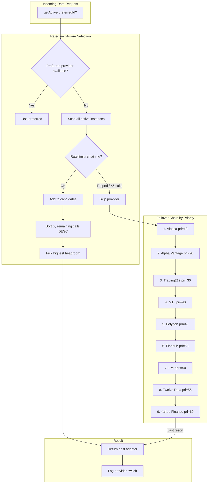
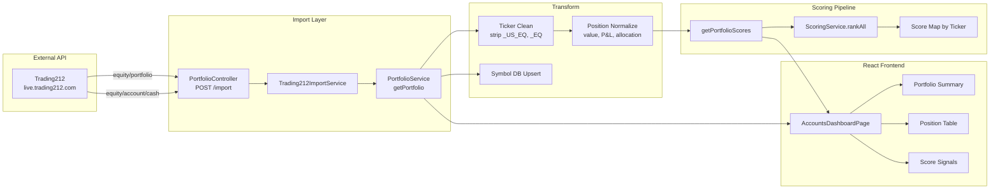
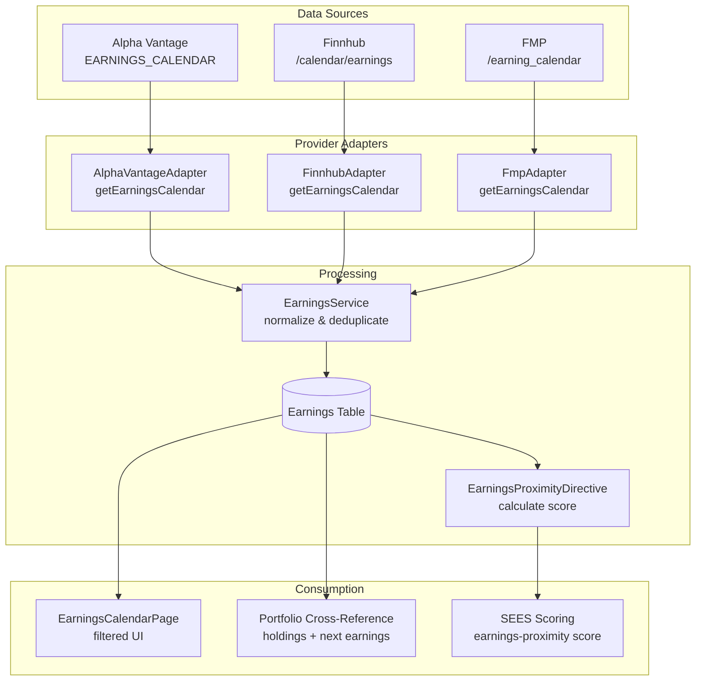

Add new Mermaid diagrams to the Diagrams page at `src/pages/DiagramsPage.jsx`.

## Current Diagrams (5 total)
- `sees-research` — SEES Research Phase
- `sees-trading` — SEES Full Trading Lifecycle  
- `data-arch` — Data Architecture
- `component-arch` — Component & Route Architecture
- `deployment` — Deployment & Infrastructure

## Diagrams to Add

### 1. Provider Failover & Rate Limiting (`provider-failover`)
Shows the AdapterFactory's rate-limit-aware provider selection, failover chain, and circuit breaker logic across all 9 registered providers.

### 2. Trading212 Portfolio Data Flow (`t212-portfolio-flow`)
Shows how portfolio data flows from Trading212 API → import → normalize → storage → scoring → UI.

### 3. Earnings Calendar Data Pipeline (`earnings-pipeline`)
Shows how earnings data should flow once Alpha Vantage EARNINGS_CALENDAR is wired, feeding the earnings-proximity directive.

## Instructions
1. Add each diagram object to the `DIAGRAMS` array in `src/pages/DiagramsPage.jsx`
2. Each object needs: `id`, `label`, `desc`, and `code` (the Mermaid code string)
3. Use `flowchart TB` (top-bottom) or `flowchart LR` (left-right) as appropriate
4. Keep descriptions to one sentence
5. Verify the Mermaid renders correctly by visiting `/builder/diagrams`

## 🏗️ Post-Implementation: Update Architecture

Using the `update-architecture-framework` skill, update `/builder/architecture-framework`:

1. **STATUS_SNAPSHOT** — Add: `[DATE]: Three new system diagrams added — Provider Failover & Rate Limiting, Trading212 Portfolio Data Flow, Earnings Calendar Data Pipeline.`
2. **REVISION_LOG** — Add entry: `Architecture diagrams — provider failover, portfolio flow, earnings pipeline`
