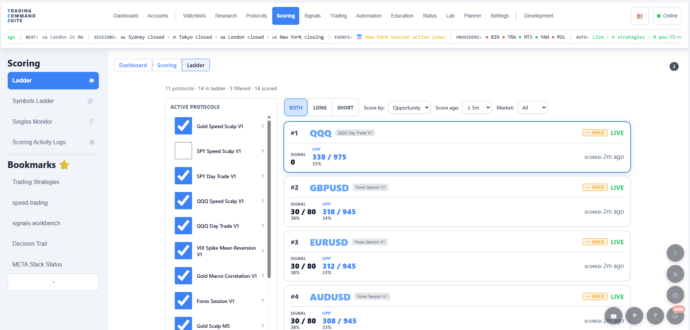
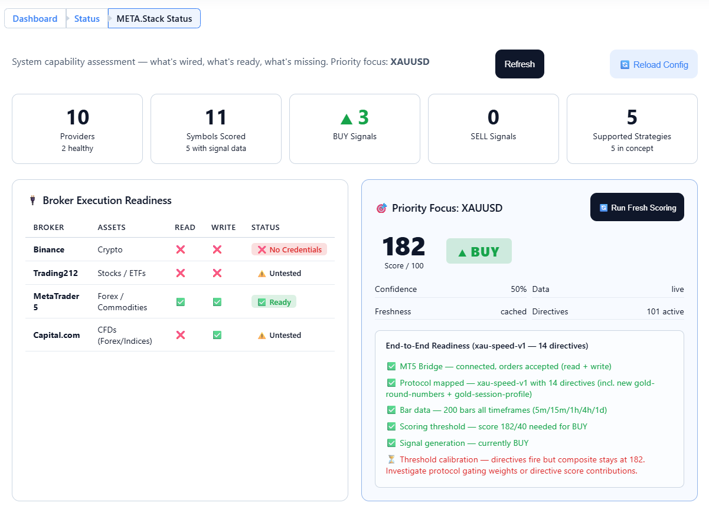

# Trading Command Suite


**Algorithmic trading & portfolio management platform.** Multi-broker, multi-session scoring engine with protocol-gated directive pipelines, automation loop, and decision-trail audit chain.

Built by [FifeCIC](https://fifecic.scot) and [Ryan Bayne](https://github.com/RyanBayne).

What it does, screenshots of every area, and the install steps are on the project website —
[fifecic.github.io/Trading-Command-Suite](https://fifecic.github.io/Trading-Command-Suite/).

## Before You Connect an Account

**This software is not configured to profit by default, and it is not financial advice.** The shipped
configuration is an engineering baseline for research and development — no strategy in it has been
shown to be profitable, and the trading performance of this project is not a feature of this release.

**Use a demo account.** Test on demo until you can explain every order the system places. Only then
consider a funded account, and never one you cannot afford to empty.

The AGPL covers the *licence*; it does not tell you the *risk*.
[DISCLAIMER.md](DISCLAIMER.md) does, and it binds by the same terms.

## Engineering Standards

<!-- STANDARDS:BEGIN — generated by `node scripts/validate-standards.cjs --write-badges`. Do not edit by hand; the build fails if this block disagrees with `src/data/standards.js`. -->
**16 standards declared · 16 backed by a gate · 0 declared gaps · 0 broken**

| | Standard | Enforced by | When |
|:-:|---|---|---|
| ✅ | No column is written that nothing reads | `scripts/audit-column-writers.cjs` | on-demand (needs a live database) |
| ✅ | The database is never rewritten from schema.prisma | `nest/scripts/validate-schema-safety.cjs` | on-demand |
| ✅ | Every settled decision is recorded in all three homes | `scripts/validate-decisions.cjs` | prebuild |
| ✅ | No private conversation is published | `scripts/validate-owner-quotes.cjs` | prebuild |
| ✅ | A public page may only state what the repository can prove | `scripts/validate-public-claims.cjs` | prebuild |
| ✅ | Colour pairs meet the contrast policy | `src/theme/semantic-contrast.test.js` | prebuild |
| ✅ | A stylesheet uses tokens, not colours of its own | `scripts/validate-css-tokens.cjs` | prebuild |
| ✅ | Every mechanism a backtest models is compared to live | `nest/scripts/validate-parity-register.cjs` | prebuild |
| ✅ | A tool nobody can find is a tool that does not exist | `scripts/tools-index.cjs` | prebuild |
| ✅ | A file lives where its concern lives | `scripts/validate-repo-hygiene.cjs` | prebuild |
| ✅ | A failure is never swallowed into a plausible empty result | `scripts/validate-no-empty-swallow.cjs` | prebuild |
| ✅ | A fault is counted in episodes and retired, never deleted | `scripts/validate-fault-taxonomy.cjs` | prebuild |
| ✅ | One formatter per concept across pages | `scripts/validate-formatters.cjs` | prebuild |
| ✅ | A component nobody can find is a component that will be duplicated | `scripts/components-index.cjs` | prebuild |
| ✅ | A page reads data through the shared client | `scripts/validate-page-data-access.cjs` | prebuild |
| ✅ | A page declares no colour of its own inside an inline style | `scripts/validate-colour-literals.cjs` | prebuild |
<!-- STANDARDS:END -->

## What It Does

- **META.Stack Scoring** (**M**odular **E**xpert **T**rading **A**rchitecture) — protocols built from inspirable directives across technical, sentiment, and risk groups. Protocol-gated scoring (~14 directives per protocol) is ~7× cheaper than flat scoring.
- **Decision Trail** — Full audit chain from trade → dispatch → gate → score → directive → market data. Queryable via `GET /api/automation/decision-trail`.
- **Automation Loop** — 120s tick cycle. Scores strategy symbols, gates through risk chains, dispatches trades, covering Tokyo, London, and US sessions.
- **Multi-Broker** — a provider-adapter layer spanning FX, equities, crypto and macro data (MT5, Alpaca, Trading212, Capital.com, Interactive Brokers, Binance, Polygon, Finnhub, FMP, Twelve Data, Alpha Vantage, ECB, FRED and others).
- **A/B Testing Foundation** — Protocol variants with `derivedFrom` lineage. LONG vs SHORT comparison stored per tick. Ready for side-by-side protocol evaluation.

Counts are deliberately not written here. Every number this README used to quote (protocols, directives,
adapters, active strategies) had gone stale, because a count in prose is a second copy of something the
system already knows — and the second copy is the one that rots. Current totals live in
[docs/GENERATED-FACTS.md](docs/GENERATED-FACTS.md), which is generated and **fails the build if it
disagrees with the repo**.

## See It Running

Scoring, gating and dispatch are all visible in the UI — nothing is a black box.

<a href="https://www.youtube.com/watch?v=aBFBvRFL17w&amp;t=232s"></a>





Full walkthrough on [YouTube](https://www.youtube.com/watch?v=aBFBvRFL17w&t=232s), and every screen on the
[showcase page](https://fifecic.github.io/Trading-Command-Suite/showcase/).

## Architecture

```
React 18 + Vite (5173)     ← PWA frontend
NestJS (3201)              ← API + scoring engine
MT5 Bridge (5000)          ← Python bridge to MetaTrader 5
MySQL + Prisma             ← Persistent state
```

## Tech Stack

- **Frontend**: React 18, Vite, TanStack Query, Zustand, Zod, PWA plugin
- **Backend**: NestJS, Prisma ORM, MySQL
- **Trading**: MT5 Python bridge, multi-provider adapter layer, protocol-gated scoring
- **Dev Tools**: Dev Overlay with inspect-to-open-in-VS-Code, feature flags, bundle budget checker

## Quick Start

```bash
git clone <repo-url> trading-command-suite
cd trading-command-suite
npm install
cd nest && npm install && cd ..

# Start the full stack (MT5 Bridge → NestJS → Vite)
pwsh -File scripts/tcs-launch.ps1

# Or individual services
npm run dev                  # Vite frontend (5173)
npm --prefix nest run start  # NestJS API (3201)
```

## Key Endpoints

| Endpoint | Purpose |
|----------|---------|
| `GET /api/health` | System health (DB, providers, queue) |
| `GET /api/scoring/gated/protocols` | List all protocols with directive groups |
| `POST /api/scoring/gated/batch` | Protocol-gated scoring (canonical META.Stack) |
| `GET /api/scoring/ranked` | Flat scoring overview (dashboards) |
| `GET /api/automation/status` | Loop state, active strategies, broker states |
| `GET /api/automation/decision-trail` | Full audit chain for any trade |
| `POST /api/system/reload-config` | Hot-reload directives + protocols (~20ms) |

## Available Scripts

- `npm run dev` — Vite dev server (5173)
- `npm run build` — Production build
- `npm run lint` — ESLint
- `pwsh -File scripts/tcs-launch.ps1` — Start full stack
- `pwsh -File scripts/tcs-stop.ps1` — Stop full stack

## Ops Notes

- Central docs: `G:/My Drive/Project Management/Live/Trading-Command-Suite-Documentation/DOCUMENTATION-INDEX.md`
- Agent rules: `.github/instructions/`
- Active sprint: `G:/My Drive/Project Management/Live/Trading-Command-Suite-Documentation/.agenticmemory/SPRINT.md`
- **Prisma — 🛑 never run `db push` here.** It drops every table with no Prisma model (**13** at present,
  including `strategy_signal_queue`, the trade execution queue) and does **not** error. For a **fresh**
  database use the `prisma migrate diff` recipe in `SETUP.md`; to change a column use `ALTER TABLE`
  followed by `npx prisma generate`. Full rules: `.github/instructions/database-schema.instructions.md`.
- **Re-deriving the counts.** Volatile numbers in any doc should be measured, not trusted:
  `npm run docs:facts` prints them, `npm run docs:facts:check` fails if the published copy is stale,
  and `GET /api/architecture/facts` returns the same facts as JSON. For live row counts (symbols,
  bars, scores) query the API — those are never published. A doc that quotes a count without one of
  these is a claim, not a fact.

## Project Links

| Resource | Location |
|---|---|
| Website | [fifecic.github.io/Trading-Command-Suite](https://fifecic.github.io/Trading-Command-Suite/) |
| Screenshots | [showcase](https://fifecic.github.io/Trading-Command-Suite/showcase/) |
| Wiki | [FifeCIC/Trading-Command-Suite/wiki](https://github.com/FifeCIC/Trading-Command-Suite/wiki) |
| Discussions | [FifeCIC/Trading-Command-Suite/discussions](https://github.com/FifeCIC/Trading-Command-Suite/discussions) |
| Issues | [FifeCIC/Trading-Command-Suite/issues](https://github.com/FifeCIC/Trading-Command-Suite/issues) |
| Contributing | [CONTRIBUTING.md](CONTRIBUTING.md) |
| Security | [SECURITY.md](SECURITY.md) |

## Licence and Support

Licensed under **AGPL-3.0** — see [LICENSE](LICENSE). Copyright (C) 2026 Ryan Bayne / FifeCIC.

This is an open-source project and you get the full benefit of it — use it, run it, read it, fork it, and
contribute to it. The AGPL's network clause means that if you run a **modified** version as a service, you
must publish your changes. That is deliberate: improvements come back to everyone instead of being
resold as a closed product.

This is one person's full-time work and it has no income. The whole app is given away — the scoring
engine, the risk controls, the position management, all of it — and it stays that way. If it earns you
something, or saves you something, [a tip or a sponsorship](https://fifecic.github.io/Trading-Command-Suite/support/)
is what keeps it being maintained; GitHub's **Sponsor** button on this page goes to the same place. Nothing
is withheld to make you pay — there is no premium edition, no crippled build, and no feature behind a
licence check. The ask is voluntary and the app is complete without it.

Contributions and ideas are welcome. The project is engineered and maintained by one person, so reviews
and replies may take time — that is the honest trade for a codebase this size.
