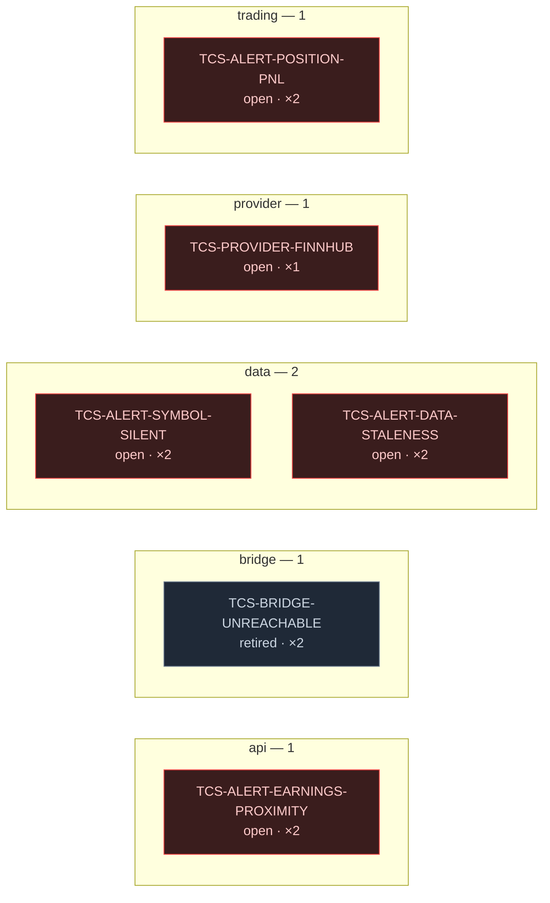

<!-- GENERATED by nest/scripts/generate-fault-map.cjs — do not edit by hand.
     Regenerate: npm --prefix nest run faults:map
     Check:      node nest/scripts/generate-fault-map.cjs --check -->

# Fault Map

Derived from the `fault` table. Each node is one fault code; the count is how many EPISODES it has been observed in, not how many times a poller looked. A retired fault keeps its node and its count — recurrence is the value being preserved (register row 227).

**6 faults · 5 open · 1 retired**

## Rows (raw values, beside the derived ones)

| code | area | status | count | first seen | reviewed | issue |
|---|---|---|---|---|---|---|
| `TCS-ALERT-EARNINGS-PROXIMITY` | api | open | 2 | 2026-11-19 | **never** | none |
| `TCS-BRIDGE-UNREACHABLE` | bridge | retired | 2 | 2026-11-19 | 2026-11-19 | [issue](https://github.com/FifeCIC/trading-command-suite/issues/1313) |
| `TCS-ALERT-SYMBOL-SILENT` | data | open | 2 | 2026-11-19 | **never** | none |
| `TCS-ALERT-DATA-STALENESS` | data | open | 2 | 2026-11-19 | **never** | none |
| `TCS-PROVIDER-FINNHUB` | provider | open | 1 | 2026-11-19 | **never** | none |
| `TCS-ALERT-POSITION-PNL` | trading | open | 2 | 2026-11-19 | **never** | none |

## Not shown here

- **Recency and cadence.** `GET /api/faults/summary` reports `neverReviewed` and `stale` (not reviewed in N days), and the Health & Diagnostics panel renders them. They are deliberately NOT in this file: `lastSeen` moves every poll while a fault is live, so a committed snapshot of it would go stale within a minute and teach everyone to ignore the staleness check.
- **The reasoning per fault.** Each fault names its GitHub issue; the issue owns the why, because a diagram is a shape and an issue is an argument.
