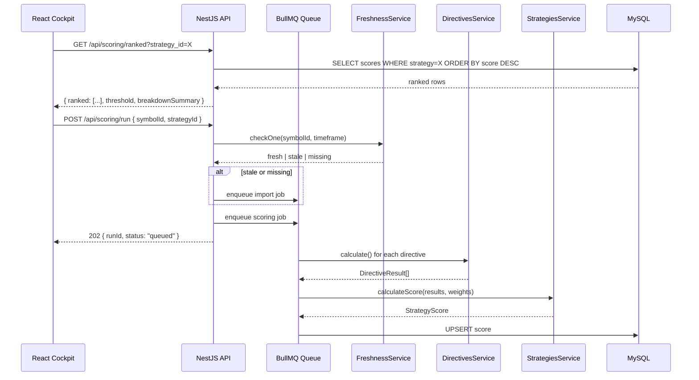

# Strategy Score Aggregation Contract

> Draft: 2026-06-10 | Task: P07 | Confidence: `confirmed` (aligned with existing interfaces/placeholders)

## Objective

Define the concrete API and data contracts for strategy score aggregation and breakdown, so that frontend and backend teams have a shared, testable contract before Task 4/5 implementation.

---

## 1. Endpoint Inventory

| Method | Path | Purpose | Status |
|---|---|---|---|
| `GET` | `/api/strategies` | List available strategies with directive weights | **New** |
| `GET` | `/api/strategies/:id` | Single strategy detail with full weight breakdown | **New** |
| `GET` | `/api/strategies/:id/score/:symbolId` | Strategy score for one symbol with directive breakdown | **New** |
| `GET` | `/api/scoring/ranked` | Ranked symbols across all strategies (or filtered by strategy) | **Existing** (partial) |
| `POST` | `/api/scoring/run` | Trigger a scoring run for a symbol or batch | **New** |

---

## 2. Request/Response Contracts

### 2.1 `GET /api/strategies`

**Response 200**:
```json
{
  "mode": "full",
  "services": { "database": true, "queue": true, "redis": false },
  "strategies": [
    {
      "id": "strat-conservative-long",
      "name": "Conservative Long",
      "description": "Low-risk long entries with volume confirmation. Favors established uptrends with pullback entries.",
      "timeframe": "1h",
      "active": true,
      "directiveCount": 5,
      "totalWeight": 100
    },
    {
      "id": "strat-aggressive-short",
      "name": "Aggressive Short",
      "description": "High-conviction short signals. Prioritizes momentum breakdowns with volume spikes.",
      "timeframe": "15m",
      "active": true,
      "directiveCount": 4,
      "totalWeight": 100
    },
    {
      "id": "strat-swing-mid",
      "name": "Swing Mid-Range",
      "description": "Multi-day swing positions using daily timeframe with ATR-based stops and trend confirmation.",
      "timeframe": "1d",
      "active": true,
      "directiveCount": 5,
      "totalWeight": 100
    }
  ]
}
```

**Validation**:
- `totalWeight` must be 100, or the strategy is flagged `active: false`.

---

### 2.2 `GET /api/strategies/:id`

**Response 200**:
```json
{
  "mode": "full",
  "services": { "database": true, "queue": true, "redis": false },
  "strategy": {
    "id": "strat-conservative-long",
    "name": "Conservative Long",
    "description": "Low-risk long entries with volume confirmation. Favors established uptrends with pullback entries.",
    "timeframe": "1h",
    "active": true,
    "entryThreshold": 60,
    "watchThreshold": 40,
    "defenseThreshold": 25,
    "weights": [
      { "directiveId": "rsi-oversold",    "name": "RSI Oversold Reversion",    "weight": 30, "description": "RSI < 30 curling upward" },
      { "directiveId": "price-above-ema",  "name": "Price Above EMA Structure", "weight": 25, "description": "Price > EMA20 > EMA50" },
      { "directiveId": "volume-confirm",   "name": "Volume Confirmation",       "weight": 20, "description": "Volume > 20-period average" },
      { "directiveId": "atr-dip",          "name": "ATR Normalized Dip",        "weight": 15, "description": "Pullback depth vs ATR" },
      { "directiveId": "macd-crossover",   "name": "MACD Bullish Crossover",    "weight": 10, "description": "MACD line crosses above signal" }
    ]
  }
}
```

**Response 404**:
```json
{
  "error": {
    "code": "STRATEGY_NOT_FOUND",
    "message": "Strategy 'strat-nonexistent' not found.",
    "details": null
  }
}
```

**Validation**:
- All `weight` values must sum to exactly 100. Server rejects writes that don't sum to 100.
- `directiveId` must reference an existing directive in the directives registry.
- `entryThreshold > watchThreshold > defenseThreshold`.

---

### 2.3 `GET /api/strategies/:id/score/:symbolId`

**Response 200** (full breakdown):
```json
{
  "mode": "full",
  "services": { "database": true, "queue": true, "redis": false },
  "strategyId": "strat-conservative-long",
  "strategyName": "Conservative Long",
  "symbolId": "uuid-of-aapl",
  "ticker": "AAPL",
  "totalScore": 64.5,
  "confidence": 0.82,
  "guidance": "Moderate buy signal — 3 of 5 directives bullish. RSI showing early reversal. Volume confirming. Entry within threshold range.",
  "threshold": "entry",
  "timeframe": "1h",
  "timestamp": "2026-06-10T14:30:00Z",
  "breakdown": [
    {
      "directiveId": "rsi-oversold",
      "name": "RSI Oversold Reversion",
      "rawScore": 72.5,
      "weight": 30,
      "contribution": 21.75,
      "confidence": 0.85,
      "reason": "RSI(14) = 28.3, curling up from oversold. Last 3 candles: 27.1 → 27.8 → 28.3."
    },
    {
      "directiveId": "price-above-ema",
      "name": "Price Above EMA Structure",
      "rawScore": 80.0,
      "weight": 25,
      "contribution": 20.0,
      "confidence": 0.90,
      "reason": "Price ($198.32) above EMA20 ($196.10) above EMA50 ($192.45). Bullish structure."
    },
    {
      "directiveId": "volume-confirm",
      "name": "Volume Confirmation",
      "rawScore": 65.0,
      "weight": 20,
      "contribution": 13.0,
      "confidence": 0.75,
      "reason": "Volume 1.2× 20-period average. Moderate confirmation, not breakout-level."
    },
    {
      "directiveId": "atr-dip",
      "name": "ATR Normalized Dip",
      "rawScore": 55.0,
      "weight": 15,
      "contribution": 8.25,
      "confidence": 0.70,
      "reason": "Pullback depth = 0.8× ATR(14). Moderate dip, not deep enough for max score."
    },
    {
      "directiveId": "macd-crossover",
      "name": "MACD Bullish Crossover",
      "rawScore": 15.0,
      "weight": 10,
      "contribution": 1.5,
      "confidence": 0.80,
      "reason": "MACD line below signal by 0.12. No crossover detected. Neutral to slightly bearish on MACD."
    }
  ]
}
```

**Response 200** (stale data — directive skipped):
```json
{
  "mode": "full",
  "strategyId": "strat-conservative-long",
  "symbolId": "uuid-of-tsla",
  "ticker": "TSLA",
  "totalScore": 38.2,
  "confidence": 0.45,
  "guidance": "Low confidence — 2 directives skipped due to stale data. Freshness check: RSI data is 3h old (threshold: 15m). Re-score after data freshens.",
  "threshold": "defense",
  "timeframe": "1h",
  "timestamp": "2026-06-10T14:30:00Z",
  "freshenssWarnings": [
    { "directiveId": "rsi-oversold", "status": "stale", "ageMinutes": 180, "thresholdMinutes": 15 },
    { "directiveId": "macd-crossover", "status": "stale", "ageMinutes": 180, "thresholdMinutes": 15 }
  ],
  "breakdown": [
    {
      "directiveId": "rsi-oversold",
      "name": "RSI Oversold Reversion",
      "rawScore": null,
      "weight": 30,
      "contribution": 0,
      "confidence": 0,
      "reason": "SKIPPED — RSI data is 3h old (threshold: 15m). Data is stale."
    },
    {
      "directiveId": "price-above-ema",
      "name": "Price Above EMA Structure",
      "rawScore": 75.0,
      "weight": 25,
      "contribution": 18.75,
      "confidence": 0.88,
      "reason": "Price ($228.15) above EMA20 ($225.30) above EMA50 ($218.90)."
    },
    {
      "directiveId": "volume-confirm",
      "name": "Volume Confirmation",
      "rawScore": 48.5,
      "weight": 20,
      "contribution": 9.7,
      "confidence": 0.65,
      "reason": "Volume 0.9× 20-period average. Below-average participation."
    },
    {
      "directiveId": "atr-dip",
      "name": "ATR Normalized Dip",
      "rawScore": 65.0,
      "weight": 15,
      "contribution": 9.75,
      "confidence": 0.72,
      "reason": "Pullback depth = 1.1× ATR(14). Healthy dip."
    },
    {
      "directiveId": "macd-crossover",
      "name": "MACD Bullish Crossover",
      "rawScore": null,
      "weight": 10,
      "contribution": 0,
      "confidence": 0,
      "reason": "SKIPPED — MACD data is 3h old (threshold: 15m). Data is stale."
    }
  ]
}
```

**Validation**:
- `contribution` = `rawScore * weight / 100` if rawScore is not null; 0 if null.
- `totalScore` = sum of all `contribution` values (already weighted, no re-division).
- `confidence` = weighted average of directive confidences (only non-skipped directives).
- `threshold` is `"entry"` if totalScore >= strategy.entryThreshold, `"watch"` if >= watchThreshold, `"defense"` if >= defenseThreshold, `null` otherwise.
- `freshenssWarnings` emitted when any directive was skipped due to stale data.
- `rawScore: null` explicitly indicates skipped — NOT `0`. A score of 0 means "this directive evaluated and found nothing" (e.g., no crossover detected). Null means "could not evaluate".

---

### 2.4 `GET /api/scoring/ranked?strategy_id={id}&limit={n}`

**This endpoint already exists.** Contract extension adds `strategy_id` filter and `breakdownSummary`.

**Response 200** (with breakdown summary — proposed extension):
```json
{
  "mode": "full",
  "services": { "database": true, "queue": true, "redis": false },
  "strategyId": "strat-conservative-long",
  "ranked": [
    {
      "symbolId": "uuid-of-aapl",
      "ticker": "AAPL",
      "score": 64.5,
      "confidence": 0.82,
      "freshness": "fresh",
      "threshold": "entry",
      "topContributor": "RSI Oversold Reversion",
      "breakdownSummary": {
        "bullish": 3,
        "neutral": 1,
        "bearish": 1,
        "skipped": 0,
        "total": 5
      },
      "timestamp": "2026-06-10T14:30:00Z"
    },
    {
      "symbolId": "uuid-of-msft",
      "ticker": "MSFT",
      "score": 58.2,
      "confidence": 0.76,
      "freshness": "fresh",
      "threshold": "watch",
      "topContributor": "Price Above EMA Structure",
      "breakdownSummary": {
        "bullish": 2,
        "neutral": 2,
        "bearish": 1,
        "skipped": 0,
        "total": 5
      },
      "timestamp": "2026-06-10T14:30:00Z"
    }
  ]
}
```

**Backward compatibility**: If `strategy_id` is omitted, the server selects the default strategy (first active strategy ordered by id). The `breakdownSummary` and `threshold` fields are new; existing consumers that only read `symbolId`, `ticker`, `score`, `confidence`, `freshness`, `timestamp` are unaffected.

---

### 2.5 `POST /api/scoring/run`

Triggers a scoring pipeline run. Can target one symbol or all active symbols.

**Request** (single symbol):
```json
{
  "symbolId": "uuid-of-aapl",
  "strategyId": "strat-conservative-long",
  "forceRefresh": false
}
```

**Request** (batch all):
```json
{
  "strategyId": "strat-conservative-long",
  "forceRefresh": false
}
```

**Response 202** (accepted — scoring is asynchronous):
```json
{
  "mode": "full",
  "services": { "database": true, "queue": true, "redis": false },
  "runId": "run-20260610-143000-a1b2c3",
  "status": "queued",
  "symbolCount": 1,
  "estimatedCompletionMs": 5000,
  "pollEndpoint": "/api/scoring/runs/run-20260610-143000-a1b2c3"
}
```

**Response 200** (synchronous fallback — when queue is unavailable):
```json
{
  "mode": "fallback",
  "services": { "database": true, "queue": false, "redis": false },
  "runId": "run-20260610-143000-sync",
  "status": "completed",
  "results": [
    {
      "symbolId": "uuid-of-aapl",
      "ticker": "AAPL",
      "totalScore": 64.5,
      "confidence": 0.82,
      "guidance": "Moderate buy signal — 3 of 5 directives bullish.",
      "threshold": "entry"
    }
  ],
  "durationMs": 3200
}
```

**Validation**:
- `symbolId` is optional. If omitted, all active symbols are scored.
- `strategyId` is optional. If omitted, all active strategies are used.
- `forceRefresh` — if `true`, freshness check is bypassed and data is re-fetched from providers. Default `false`.

---

## 3. Error Envelope

All error responses use a consistent envelope. HTTP status code is the primary error indicator.

```json
{
  "error": {
    "code": "ERROR_CODE",
    "message": "Human-readable description.",
    "details": null
  }
}
```

### Error Codes

| HTTP | Code | When |
|---|---|---|
| 400 | `VALIDATION_ERROR` | Request body fails Zod/class-validator checks. `details` contains field-level errors. |
| 400 | `INVALID_WEIGHTS` | Strategy weights do not sum to 100. `details` contains `{ sum: 85, expected: 100 }`. |
| 400 | `UNKNOWN_DIRECTIVE` | A weight references a directive ID not in the registry. |
| 404 | `STRATEGY_NOT_FOUND` | Strategy ID does not exist. |
| 404 | `SYMBOL_NOT_FOUND` | Symbol ID does not exist or is inactive. |
| 409 | `SCORING_IN_PROGRESS` | A scoring run is already active for this symbol/strategy combo. `details` contains `{ existingRunId: "..." }`. |
| 422 | `INSUFFICIENT_DATA` | Strategy requires data that is missing (not just stale). `details` contains list of missing data types. |
| 500 | `INTERNAL_ERROR` | Unexpected server error. `details` scrubbed of internals in production. |
| 503 | `SERVICE_UNAVAILABLE` | Scoring pipeline is disabled or queue is down and sync fallback failed. |

### Validation Error Details (400)

```json
{
  "error": {
    "code": "VALIDATION_ERROR",
    "message": "Request validation failed.",
    "details": [
      { "field": "forceRefresh", "message": "Expected boolean, received string." },
      { "field": "symbolId", "message": "Must be a valid UUID." }
    ]
  }
}
```

---

## 4. Validation Constraints Summary

| Rule | Scope | Enforcement |
|---|---|---|
| Weights must sum to 100 | Strategy config | Server-side write rejection |
| directiveId must exist in registry | Strategy config | Server-side write rejection |
| entryThreshold > watchThreshold > defenseThreshold | Strategy config | Server-side write rejection |
| timeframe must be valid enum | Strategy config | Server-side write rejection |
| symbolId must be active | Scoring run | 404 if inactive |
| request body must match schema | All POST | 400 with field details |
| forceRefresh must be boolean | POST /scoring/run | 400 |
| limit must be 1–100 | GET /scoring/ranked | Clamped server-side |
| strategy_id must exist | GET /strategies/:id/score/:symbolId | 404 |

---

## 5. Compatibility Notes for React Components

### 5.1 `SeesScoringPanel.jsx` (Current)

**What it consumes now**:
- `GET /api/scoring/ranked` → `{ mode, ranked: [{ symbolId, ticker, score, confidence, freshness, timestamp }] }`

**Contract impact**:
- **Backward compatible**: The existing response shape is preserved. New fields (`strategyId`, `threshold`, `topContributor`, `breakdownSummary`) are additive.
- **Proposed upgrade path**: Add a `strategyId` prop passthrough; when set, append `?strategy_id={strategyId}` to the fetch URL. When `breakdownSummary` exists, render bull/bear/neutral chip counts.
- **No breakage**: Old consumers that read only `symbolId`, `ticker`, `score`, `confidence`, `freshness` continue working.

### 5.2 `SeesLiveStackMockPage.jsx` (Current)

**What it consumes now**:
- `GET /api/scoring/ranked` via TanStack Query with `refetchInterval`
- Local SEES engine fallback (`buildSeesRanking`)

**Contract impact**:
- **Threshold field**: Currently the page shows thresholds from the local engine (`entryThreshold`, `watchThreshold`, `defenseThreshold`). The new `GET /api/strategies/:id` endpoint provides this data from the server. The page should prefer server thresholds when available.
- **Guidance field**: The `guidance` string from the scoring response can replace or supplement the strategy description paragraph.
- **Skipped directives**: The `freshenssWarnings` array should drive a warning banner when directives are skipped due to stale data — this replaces the current generic "symbols need price data" empty state.

### 5.3 New Components (Recommended)

| Component | Consumes | Purpose |
|---|---|---|
| `StrategySelector` | `GET /api/strategies` | Dropdown to pick active strategy |
| `StrategyDetailPanel` | `GET /api/strategies/:id` | Shows weights, thresholds, directive descriptions |
| `ScoreBreakdownRow` | `GET /api/strategies/:id/score/:symbolId` | Expandable row in the ranked table showing per-directive contributions |
| `FreshnessWarningBanner` | `freshenssWarnings` from score response | Warning when directives were skipped due to stale data |
| `ScoringRunButton` | `POST /api/scoring/run` | Manual trigger with progress polling |

---

## 6. Data Flow Diagram



---

## 7. TypeScript Type Alignment

The contract aligns with these existing types. No rename needed.

| Contract Field | Nest Type | Location |
|---|---|---|
| `totalScore` | `StrategyScore.totalScore` | `strategies.service.ts` |
| `confidence` | `StrategyScore.confidence` | `strategies.service.ts` |
| `breakdown[].directiveId` | `ScoreBreakdownItem.directiveId` | `strategies.service.ts` |
| `breakdown[].rawScore` | `ScoreBreakdownItem.rawScore` | `strategies.service.ts` |
| `breakdown[].weight` | `ScoreBreakdownItem.weight` | `strategies.service.ts` |
| `breakdown[].contribution` | `ScoreBreakdownItem.contribution` | `strategies.service.ts` |
| `totalScore` | `StrategyScoreDto.totalScore` | `score-breakdown.dto.ts` |
| `guidance` | `StrategyScoreDto.guidance` | `score-breakdown.dto.ts` |
| `ranked[].score` | `RankedSymbol.score` | `scoring.service.ts` |
| `ranked[].confidence` | `RankedSymbol.confidence` | `scoring.service.ts` |
| `ranked[].freshness` | `RankedSymbol.freshness` | `scoring.service.ts` |

---

## 8. Open Questions (for Task 4/5 implementers)

1. **Q1**: Should `/api/strategies/:id/score/:symbolId` cache results for `staleThresholdMinutes` or always recompute? _Recommendation: cache with freshness-gated recomputation._
2. **Q2**: Should `breakdownSummary` (bullish/neutral/bearish/skipped counts) be computed server-side or client-side from the full breakdown? _Recommendation: server-side for ranked list; client-side for detail view._
3. **Q3**: Scoring run concurrency — if two requests trigger scoring for the same symbol, should the second return 409 or join the existing job? _Recommendation: 409 with existing run ID for now; dedup later._
4. **Q4**: Should `freshenssWarnings` be returned on the ranked list or only on the detail endpoint? _Recommendation: summary on ranked list (count of skipped), detail on breakdown endpoint._

---

*End of contract draft. Ready for Task 4/5 implementation.*
