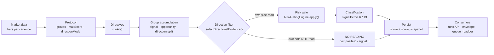

# Scoring Engine — Architecture Reference

**Status:** stable · **Category:** C (reference / contract) · **Created:** 2026-08-16 ·
**Last updated:** 2026-10-20 · **Owner:** primary agent

**Source of truth:** `nest/src/modules/scoring/protocol-gating.service.ts`
(`scoreWithGating()` is the ONE evaluator; `selectDirectionalEvidence()` in `score-units.ts` owns
direction; `risk-gating-engine.service.ts` owns the multiplier).

**Durable reasoning:** #638 (dual score) · #758 (stable denominator + no-data) · #761 (band
recalibration) · #818 (BOTH removed) · #915 (breadth vs conviction) · #1117 (table retention) ·
#1122 (capacity that scores 0) · #1131 (measured ceilings vs fixed thresholds).
**Settled rows:** `docs/SETTLED-DECISIONS.md` 1–10.

**Companion surfaces**

| Surface | Route | Answers |
|---|---|---|
| Diagrams | `/development/diagrams` | the shape of the pipeline and the direction filter |
| META.Stack Explorer | `/status/meta-stack-explorer` | stage-by-stage **live values** for a symbol |
| Ladder | `/scoring/live-ordering-stack` | which opportunity is strongest right now |
| Scoring Mechanics panel | `/trading/trading-bots` | one reading, number by number |
| Signals Workbench | `/lab/signals-workbench` | single-directive probes |

---

## 0. The one-paragraph model

A **protocol** is a named set of directives with a `maxScore` each and a declared
`directionMode`. For one symbol it runs those directives, sums what fired into **two** numbers:
**Opportunity** (everything counts — for ranking) and **Signal** (only the protocol's own
direction counts — for timing). The **Signal percentage divides by the protocol's CONFIGURED
capacity**, never by what happened to fire. If no directive read the protocol's own direction this
tick, there is **no reading at all** — the row is `NO_READING` with `signalPct` 0 and `composite`
0. That zero is an *absence*, not a scored zero and not a `HOLD`. Everything else in this document
is a consequence of those four sentences.

---

## 1. Where the engine sits



The engine is **one function** entered from many callers. Every caller supplies a real protocol;
unscoped scoring was removed (2026-08-22) and `scoreWithGating()` throws without one.

| Caller | `persistNoData` | Why |
|---|---|---|
| Signal envelope → Ladder | **true** | the ladder must show a current reading on every tick |
| Portfolio scorer, speed scan, HTTP routes, replay, backtest | false | a no-evidence tick writes nothing |

---

## 2. Stage-by-stage contract

Read this table before changing anything in the engine. "Persists" names the only side effects.

| # | Stage | Code | Input | Output | Persists |
|---|---|---|---|---|---|
| 1 | **Protocol load** | `protocolDb.findBySlug()` | `protocolId` | `groups[]`, `directionMode` (default `LONG_ONLY`) | — |
| 2 | **Directive set** | loop over `group.directiveIds` | groups | unique id set; first occurrence wins, later duplicates skipped + warned | — |
| 3 | **Effective maxScore** | `resolveEffectiveMaxScores()` | id set | protocol override → global config → directive class → `100` | — |
| 4 | **Run directives** | `directivesService.runAll(input, ids)` | symbol, bars, timeframe, `asOf` = last bar's timestamp, DXY proxy, higher-TF bars | `Map<id, DirectiveResult>` — `score`, `maxScore`, `signalClass`, `unmeasured` | — |
| 5 | **Readiness** | inclusion classification | results | `ready` counted; `beta` blocks `readinessGate.ready`; `alpha` **excluded** into `excludedBreakdown` | — |
| 6 | **Group loop** | `scoreWithGating()` group phase | results + group config | per group: `signalRaw/Max` (observed), `capacityMax` (configured), `oppRaw/Max`, `bullishRaw/Max`, `bearishRaw/Max` | — |
| 7 | **Direction filter** | `selectDirectionalEvidence(mode, evidence)` | the four direction accumulators | `{ direction, raw, maximum, percentage }` — `direction` is `bullish` / `bearish` / **`none`** | — |
| 8 | **No-evidence branch** | `hasDirectionalEvidence` | capacity counters | early return: `composite 0`, `signalPct 0`, `noData: true`, `riskMultiplier 1` | only if `persistNoData` |
| 9 | **Risk gate** | `riskEngine.apply(totalRaw, riskDirectives)` | selected raw + risk group | `finalScore`, `multiplier`, `hardGateTriggered`, chain | — |
| 10 | **Composite** | `Math.round(max(0, finalScore))` | risk output | gated raw points — **no 0–100 clamp** | — |
| 11 | **Classification** | band comparison | `signalPct` | `STRONG_BUY` / `BUY` / `HOLD` / `SELL` / `STRONG_SELL` | — |
| 12 | **Rarity** | `computeRarity()` | composite + snapshot history | percentile (1–100) | read only |
| 13 | **Market status** | `computeMarketStatus()` + `venueForSymbol()` | bars, venue | `open`, `stale`, `asOf`, `reason` | — |
| 14 | **Persist** | `storeSnapshot()` | everything above | — | `score` (+ `score_snapshot` unless skipped) |
| 15 | **Return** | `GatedScore` | — | canonical shape — every consumer reads this | — |

### Stage 4 detail — what a directive returns

| Field | Meaning |
|---|---|
| `score` | **magnitude**, 0…`maxScore`. Never a percentage, never clamped (ADR-010) |
| `maxScore` | the weight this directive carries in this protocol |
| `signalClass` | **runtime** direction: `bullish` / `bearish` / `neutral`. Direction lives here, not in `score` |
| `unmeasured` | `true` when the directive could not measure — contributes nothing and can never trip a gate |

### Stage 6 detail — the three accumulators

```text
capacityMax        += maxScore                        when !isGateGroup      (CONFIGURED)
signalRaw          += score  }  when !isGateGroup && signalClass === own side
signalMax          += maxScore}                        (OBSERVED — diagnostic only)
bullishRaw/Max     += score/maxScore  when !isGateGroup && signalClass === 'bullish'
bearishRaw/Max     += score/maxScore  when !isGateGroup && signalClass === 'bearish'
oppRaw/Max         += score/maxScore  ALWAYS (gates included)
```

⚠️ `capacityMax` deliberately does **not** test `directionBias` (settled row 9). It tests only
`!isGateGroup`. A `directionBias` test was tried and reverted: declared bias badly understates
what directives actually emit, and gating on it shrinks every denominator.

---

## 3. The two scores

### 3.1 Opportunity — "everything counts"

```text
opportunityScore = Σ every group's raw scores       (gates included)
opportunityMax   = Σ every group's maxScores
opportunityPct   = opportunityScore / opportunityMax × 100
```

Purpose: ranking and screening. It is **not** a timing signal. A high Opportunity score says
"good candidate", not "buy now".

### 3.2 Signal — "directional conviction"

```text
signalRaw      = Σ score  over non-gate directives reading the PROTOCOL'S OWN direction
signalDenominator = configuredSignalMax   (= Σ maxScore of every non-gate directive)
                    ▲ falls back to the observed max ONLY when a protocol has no non-gate
                      directives at all — unreachable in practice
signalPct      = signalRaw / signalDenominator × 100
composite      = signalRaw × risk multiplier   (0 when a hard gate vetoes)
```

### 3.3 The denominator law (settled row 2 / ADR-011)

| Value | Meaning | May be a denominator? |
|---|---|---|
| `configuredSignalMax` | Σ maxScore of every **non-gate** directive. Fixed by config — same for every symbol, every tick | ✅ **the only one** |
| `observedSignalMax` | Σ maxScore of directives that read directional **this tick** | ❌ diagnostic only |
| `subMaxTotals[group]` | per-group observed pair | ❌ same trap, one level down |

Why: an observed denominator **shrinks** when a directive goes quiet, so a quieter tick scores
*higher*. It is also per-symbol, so one protocol could price two symbols against two maxima in the
same tick, and it made the stored series non-comparable (`forex-session-v1` wrote five
denominators in 30 minutes — #758).

**One denominator everywhere.** `signalPct`, the persisted `rawMax`, the card, the label and the
pre-trade gate all divide by `configuredSignalMax`. A fourth place computing its own denominator
is a bug.

---

## 4. Direction resolution — the filter that makes a signal *zero*

`selectDirectionalEvidence()` is a **presence test**, not a magnitude comparison:

```ts
direction = mode === 'LONG_ONLY'
  ? (bullishMax > 0 ? 'bullish' : 'none')
  : (bearishMax > 0 ? 'bearish' : 'none');
```

| Mode | Counts | Reads `none` when |
|---|---|---|
| `LONG_ONLY` | `bullish` readings only | **no non-gate directive read bullish this tick** |
| `SHORT_ONLY` | `bearish` readings only | no non-gate directive read bearish this tick |

`BOTH` was **deleted** 2026-09-15 (#818). It decided its side at runtime by comparing two
percentages normalised against two different moving denominators, so the side could flip on
*participation* rather than strength (#813). Do not re-add it: a LONG/SHORT **pair** is the
intended A/B mechanism.

`hasDirectionalEvidence` then decides whether the tick is a reading at all:

```ts
hasDirectionalEvidence = capacityMaxTotal > 0
  ? directionEligibleTotal > 0 && observedMaxTotal > 0
  : totalMax > 0;
```

If it is false the engine returns the **no-data** shape: `composite 0`, `signalRaw 0`,
`signalPct 0`, `signalMax = configuredSignalMax`, `noData: true`. The denominator is kept so the
row stays readable — it is `0 / 1295`, not `0 / 0`.

> **A protocol with evidence against it is indistinguishable, in the Signal, from a protocol with
> no evidence at all.** Bearish readings in a LONG_ONLY protocol are recorded
> (`bearishRaw` / `bearishMax`) and **excluded** from both the numerator and `observedMaxTotal`.
> That is intended (bearish evidence must never increase BUY strength) and its consequence is the
> single most common cause of a "zero signal" report.

### 4.1 Measured — `BTC` / `btc-speed-v1`, 2026-10-20

Same protocol, same symbol, six minutes apart:

| Tick | bullish | bearish | selected | Signal | Opportunity |
|---|---|---|---|---|---|
| 09:32Z (the reported card) | `0 / 0` | `205 / 515` | **none** | **0 / 1295 — 0%**, `NO_READING` | 453 / 1395 — 32% |
| 09:36Z | `0 / 0` | `212 / 635` | **none** | **0 / 1295 — 0%**, `NO_READING` | 426 / 1395 — 31% |
| 09:46Z | `37 / 60` | `243 / 540` | bullish | **37 / 1295 — 2.9%**, `HOLD` | 527 / 1395 — 38% |

Read the third row carefully: one directive read **61.7% of its own capacity** bullish
(37/60) and the protocol's Signal still reads **2.9%**, because the denominator is 1295. That is
section 5, not a second fault.

Measured over 24 h for this protocol (`score` table, 2026-10-19 09:00 → 2026-10-20 09:00):
**123 ticks, 99 `NO_READING` (80%)**. The 24 ticks that did read bullish scored 52–134 composite
(4.0–10.3%), i.e. `HOLD` to `BUY`. So the card alternates between "0" and "low", never between
"0" and "healthy" — both symptoms have the same two causes.

### 4.2 What this does and does not mean

| ✅ It means | ❌ It does not mean |
|---|---|
| No directive for this protocol read the protocol's own direction this tick | That the score was thrown away — the row is written (`score` table) |
| The bearish case is real and is being recorded, not counted | That the market is neutral |
| The protocol's own ceiling caps what it can ever show (section 5) | That the threshold is mis-set for this protocol (that is #1131) |

---

## 5. Capacity dilution — why a good reading is a small percentage

`signalPct` divides **one side's fired points** by **the whole protocol's configured capacity**.
Adding a directive therefore *subtracts* from every future percentage even when it never fires.

Measured ceilings (`GET /api/scoring/gated/thresholds`, `windowDays: 7`, 2026-10-20 09:41Z) —
the highest percentage each protocol has actually reached:

| Protocol | Directives | Ceiling | Samples |
|---|---|---|---|
| `probe-1dir-rsi` | 1 | **100%** | 279 |
| `probe-1dir-v1` | 1 | **60%** | 240 |
| `hourly-3dir-v1` | 3 | 42.4% | 1,486 |
| `earnings-momentum-v1` | — | 31.0% | 29 ⚠️ |
| `spy-speed-v1` | — | 28.8% | 2,266 |
| `vix-short-v1` | 7 | 28.4% | 6,474 |
| `forex-session-v1` | — | 27.3% | 40,049 |
| `btc-scalp-v1` | — | 26.2% | 14,516 |
| `xau-speed-m15` | 11 | 24.2% | 6,885 |
| **`btc-speed-v1`** | — | **21.8%** | **7,652** |
| `xau-speed-4h` | — | 17.3% | 6,124 |

Against the live bands (`entry: 6`, `strong: 13`) and the pre-trade gate (`speed: 13`,
`day-trade: 10`, `scalp: 12`, `swing: 9`, `position: 7`):

| Bar | `btc-speed-v1` (ceiling 21.8%) consumes |
|---|---|
| Entry 6% | 28% of everything it has ever achieved |
| Strong 13% | 60% of everything it has ever achieved |

**Consequence:** `STRONG_BUY` is only reachable on protocols with one or two directives. This is
#1131 (thresholds vs measured ceiling) and #1122 (20.7% of directive readings score exactly 0
while their capacity stays in the denominator). Both are **maths changes** and need a copied
configuration plus a monitored comparison — see `maths-change-requires-ab`.
⚠️ `earnings-momentum-v1` has 29 samples: do not use it to argue anything.

---

## 6. Classification bands and the signal vocabulary

### 6.1 Bands — live values

| Boundary | Value | Meaning |
|---|---|---|
| `STRONG_PCT` | **13%** | `STRONG_BUY` / `STRONG_SELL` |
| `ENTRY_THRESHOLD` | **6%** | `BUY` / `SELL` |
| below entry | — | `HOLD` = no directional edge, **not** position advice |

Scale: **percent of configured directional capacity** (ADR-011). The values were rescaled
2026-09-15 (40→6, 80→13, gate 65→10) and are pinned by `signal-threshold-scale.spec.ts` — settled
row 10. Both are exported through `SIGNAL_THRESHOLDS` so Settings renders the live values.

### 6.2 The states a card can show

| Value | Written by | Means | Counted? |
|---|---|---|---|
| `STRONG_BUY` / `STRONG_SELL` | engine | ≥ `STRONG_PCT` in the protocol's own direction | yes |
| `BUY` / `SELL` | engine | ≥ `ENTRY_THRESHOLD`, below strong | yes |
| `HOLD` | engine | directional evidence exists, below entry | yes |
| **`NO_READING`** | persistence (`persistNoData`) | no reading of the protocol's own direction | row written, **not counted** |
| **`NO_DATA`** | `scoreWithGating()` return | same tick, API vocabulary | — |
| `undefined` / absent | legacy rows | predates the field | — |

⚠️ **Two vocabularies for one state**: the API return says `NO_DATA`; the database row says
`NO_READING`. Both are deliberate (the DB value is queryable and distinct from `HOLD`), but a
reader comparing `/api/scoring/gated/:symbol` with `/api/scoring/runs` sees two words for one
thing.

---

## 7. Persistence — the two tables, and what each deliberately omits

Both writes live in `storeSnapshot()`, sequentially, fire-and-forget.

| Table | Holds | Typical row | Retention | Read by |
|---|---|---|---|---|
| `score` | **the reading history** — `value`, `signal`, full `breakdown` JSON | one per tick | **30 d** (`DATA_RETENTION_SCORE_DAYS`) | `/api/scoring/runs`, Ladder, diagnostics |
| `score_snapshot` | **the rarity distribution** — `composite`, `signal`, `signalPct`, `opportunityPct` | one per **reading** | **90 d** (`DATA_RETENTION_SNAPSHOT_DAYS`) | `computeRarity()`, percentile bands, position sizing |

### 7.1 Write matrix

| Tick | `score` | `score_snapshot` | Rarity |
|---|---|---|---|
| Directional evidence present | ✅ | ✅ | computed |
| No evidence, `persistNoData: true` (Ladder) | ✅ `NO_READING` | ❌ **skipped** | ❌ skipped |
| No evidence, `persistNoData: false` | ❌ | ❌ | ❌ |
| Protocol `active = 0` (#803) | ❌ refused + warn | ❌ | ❌ |
| Symbol not in the protocol's resolved set | ❌ | ❌ | ❌ |

⚠️ **Why `score_snapshot` skips `NO_READING` — and why that is still an analytics gap.**
`computeRarity()` counts how many historical composites sit below the current one. A `0` row every
two minutes would fill that distribution with zeros and silently reclassify every live score as
rarer than it is — and rarity drives position sizing, so that is a money-path change. **So the
skip is correct.** The consequence is that the only history containing no-reading ticks is
`score`, which retains 30 days while `score_snapshot` retains 90. Any "how often was the signal
zero?" question must therefore be asked of `score`, over ≤30 days, and any long-window statistic
over `score_snapshot` is blind to exactly those ticks (#1117).

### 7.2 The breakdown JSON — what a row can answer on its own

`score.breakdown` carries: `rawComposite`, `rawMax`, `signal`, `directionMode`,
`directionalEvidence` (`bullishRaw/Max`, `bearishRaw/Max`, `selected`), `subScores`,
`subRawTotals`, `subMaxTotals`, `breakouts` (per directive: `score`, `maxScore`, `signalClass`,
`inSignal`, `reason`, `unmeasured`), `configuredSignalMax`, `observedSignalMax`,
`denominatorMode`, `opportunityScore/Max/Pct`, `marketStatus`, `readinessGate`.

⚠️ `rawComposite` is **not** `composite`: it is the pre-gate signal sum. `rawMax` is the
**configured** denominator. A reader that recomputes `rawComposite / rawMax` gets `signalPct`
exactly — that contract holds on every path (#758 follow-up).

---

## 8. Consumers — and the one number each must read

| Consumer | Endpoint / call | Reads | Must not |
|---|---|---|---|
| Ladder (`/scoring/live-ordering-stack`) | `GET /api/scoring/runs` | `rawComposite`, `rawMax`, `signal`, `directionalEvidence` | re-derive BUY/HOLD/SELL locally |
| Signal envelope | `buildBestLadder()` → `scoreWithGating(..., { persistNoData: true })` | full `GatedScore` | invent a threshold |
| Pre-trade gate | `execution-feasibility` + style threshold | `signalPct` | use `composite` as a percentage |
| Automation loop | `buildBestLadder` → queue | `signal` + `signalPct` | treat `NO_DATA` as `HOLD` |
| Protocols Registry | `GET /api/scoring/gated/protocols` | last score per protocol | — |
| META.Stack Explorer | `POST /api/scoring/gated/batch` | live stage values | — |
| Ceilings / thresholds | `GET /api/scoring/gated/thresholds` | `score_snapshot` percentiles | claim "all-time" — the window is bounded |

**Ladder ordering** (`LadderPage` sorter): live-and-scored first, then any scored, then by the
selected metric (`pct` = Signal, `opp` = Opportunity). A `NO_READING` card **is** scored (0) and
LIVE, so it ranks below every positive-percentage card — which is why a stale `STRONG_BUY` used to
outrank a current no-reading before `persistNoData` existed.

---

## 9. Diagnostics — "I see X, so read Y"

This is the section to use before changing anything.

| Symptom | Most likely stage | Read this | Then |
|---|---|---|---|
| Signal reads **0 / capacity** | 7 – direction filter | `breakdown.directionalEvidence.selected` | `none` + a populated opposite side ⇒ the protocol's own side did not read. Not a bug, not a persistence fault |
| Signal reads **0** *and* evidence is absent entirely | 4 / 5 – directives or readiness | `breakdown.breakouts[*].signalClass`, `readinessGate` | every directive neutral or all `alpha`-excluded |
| Signal **low but non-zero** (2–5%) | 5 – dilution | ceiling from `/thresholds` | if `signalPct` is a large share of the ceiling, thresholds are the question (#1131) |
| Card shows a **different %** from the label | any | `rawComposite / rawMax` vs `signalPct` | they must be equal; if not, a denominator was recomputed somewhere (#758) |
| **Stale** card, market open | 14 – persistence | `score` newest row for (protocol, symbol) | no rows ⇒ the tick path is not running for this protocol, not a display fault |
| Card **missing entirely** | 1–4 | protocol `resolvedSymbols`, `readinessGate` | not resolved / not ready / every cadence stale (#827) |
| `NO_READING` rows absent from history | 14 | `score` vs `score_snapshot` | by design — see 7.1 |
| Two symbols, same protocol, **different denominators** | 3 – denominator law | `rawMax` per row | must be identical; a difference is an ADR-011 violation |
| Score written for an **inactive** protocol | 14 | log `Score write REFUSED` | #803 kill switch; should be impossible |

### 9.1 Commands

```powershell
# live reading for one symbol/protocol (includes meta.directionalEvidence)
curl.exe -s "http://localhost:3201/api/scoring/gated/BTC?protocol=btc-speed-v1"

# newest rows, all protocols
curl.exe -s "http://localhost:3201/api/scoring/runs?limit=20"

# live bands, per-style gate, and measured ceilings
curl.exe -s "http://localhost:3201/api/scoring/gated/thresholds"

# the history rows behind a card (schema: score, score_snapshot)
C:\wamp64\bin\mysql\mysql9.1.0\bin\mysql.exe -utradingcs -ptradingcs_dev_2026 -D tradingcs -e "SELECT value, JSON_UNQUOTE(JSON_EXTRACT(breakdown,'$.signal')) sig, JSON_EXTRACT(breakdown,'$.directionalEvidence') de, timestamp FROM score WHERE strategyId='btc-speed-v1' ORDER BY timestamp DESC LIMIT 10;"
```

---

## 10. Change-safety — what is load-bearing

| Change | Safe? | Rule |
|---|---|---|
| Reorder groups | ✅ | group order decides only which duplicate wins |
| Add/remove a directive in a protocol | ⚠️ | moves `configuredSignalMax` ⇒ every percentage moves ⇒ **maths change**; a copy + A/B |
| Change a `maxScore` | ⚠️ | same — maths change |
| Change `ENTRY_THRESHOLD` / `STRONG_PCT` | ⚠️ | maths change; must update `signal-threshold-scale.spec.ts` (settled row 10) |
| Change `directionMode` | ⚠️ | changes which side can ever score — the protocol's whole meaning |
| Rename `weightStrategy` values | ⚠️ | **inert** — never branched on; renaming was rejected (register row 31) |
| Fix a directive returning a wrong `score` | ✅ | a bug fix that restores intent — cite the intent and the evidence |
| Add a diagnostic field | ✅ | additive; keep the return shape in parity with the canonical path |
| Skip persisting a state | 🛑 | #758's over-correction — the owner requires history to be kept |
| Add a second denominator | 🛑 | ADR-011; guarded by `INV-STABLE-DENOMINATOR` |

**Guard scripts that already exist for this area**

```powershell
npm --prefix nest run typecheck        # stage 1
node scripts/verify-diagram-claims.cjs # diagrams vs the live API (exit 2 = cannot verify)
node scripts/analyse-unreachable-capacity.cjs   # capacity the numerator can never reach
npm --prefix nest run audit:bot-activation       # can this bot trade right now?
```

---

## 11. Non-negotiable invariants

Kept from the original contract — each was paid for by a real defect:

1. Raw score, maximum, percentage, confidence and risk multiplier are **distinct units**. A raw
   score must never be persisted into a percentage field.
2. Bullish and bearish evidence stay separate until the direction filter resolves them. Protocol
   intent cannot turn bearish evidence bullish (and vice versa).
3. Every evaluation carries an explicit `asOf` — **the evaluated candle's timestamp**, not the
   process clock — so live, replay and backtest are reproducible.
4. **Missing, stale, neutral and zero are four different states** and must not share a fallback.
5. Queue entries reference an immutable persisted decision; every execution path re-runs the same
   fail-closed feasibility policy before the broker call.
6. Live, API, replay, backtest and scheduler use **one** evaluator and produce identical results
   for identical inputs.
7. A verifier that cannot read its input must **error**, never pass.

---

## 12. Glossary

| Term | Meaning |
|---|---|
| **Protocol** | named directive set + `maxScore` per directive + `directionMode` |
| **Directive** | one check returning `score`, `maxScore`, `signalClass` |
| **Group** | `technical` / `sentiment` / `risk`; `risk` with `isRiskGate` is a **gate group** |
| **configuredSignalMax** | Σ maxScore of every non-gate directive — the denominator |
| **observedSignalMax** | Σ maxScore of what read directionally this tick — diagnostic only |
| **composite** | gated raw signal points (`signalRaw × risk multiplier`) — **not** a percentage |
| **rawComposite** | pre-gate signal points |
| **signalPct** | `signalRaw / configuredSignalMax × 100` — the classification input |
| **Opportunity** | additive "everything counts" score — ranking only |
| **`inSignal`** | per-directive breakdown flag: counted in the Signal |
| **NO_READING / NO_DATA** | no reading of the protocol's own direction this tick |
| **directionMode** | `LONG_ONLY` \| `SHORT_ONLY` — the protocol's declared side |
| **readiness** | `ready` / `beta` (blocks) / `alpha` (excluded) |

---

## 13. Change log

| Date | Change |
|---|---|
| 2026-08-16 | Dual-score model (Phase C, #638) replaces the single composite |
| 2026-09-10 | Stable denominator — `configuredSignalMax` becomes the only denominator (#758) |
| 2026-09-15 | Bands rescaled 6 / 13; `BOTH` direction mode deleted (#818) |
| 2026-09-23 | `weightStrategy` declared INERT; denominator hardcoded (register row 31) |
| 2026-10-19 | A neutral tick is RECORDED as `NO_READING` (owner-directed amendment to #758) |
| 2026-10-19 | `directionalEvidence` is persisted, so a `0` can be told apart from "nothing measured" |
| 2026-10-20 | This reference rewritten: stage contracts, direction filter, persistence matrix, diagnostics |
