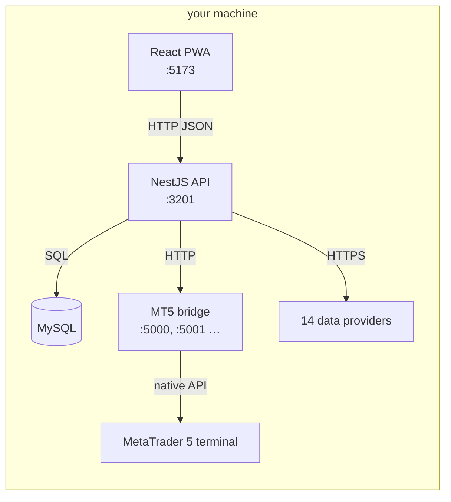
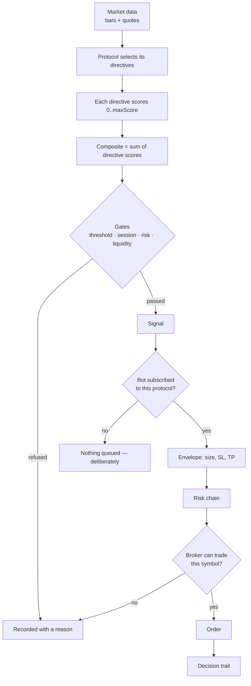

# How It Works

**Status:** active
**Category:** E (product / user)
**Created:** 2026-10-31
**Last updated:** 2026-10-31
**Owner:** TCS team

<!-- Source for the published wiki page. Generated by scripts/publish-public-docs.cjs — edit here. -->

Three processes and a database. Nothing is hosted; there is no service in the middle.

## The four moving parts

| Part | Port | What it is |
|---|---|---|
| **Frontend** | 5173 | React + Vite PWA. Renders server-computed state; it does not re-derive a score from a number |
| **API** | 3201 | NestJS. Scoring, gating, automation loop, persistence, and every business rule |
| **Bridge** | 5000 + | A Python process, one per brokered account, holding the MetaTrader 5 terminal connection |
| **Database** | 3306 | MySQL via Prisma |

## The scoring pipeline

**Why the order matters.** A score that never becomes a trade is not a failure — it is a filter
working. The stages are ordered cheapest-first so the expensive work (broker capability checks, order
validation) only runs on candidates that already survived the cheap ones.

## Two things people misread

**A composite is not a percentage.** Each directive declares its own `maxScore`, and the protocol total
is the sum of those. The UI shows a normalised 0–100 for display only; the stored number is unbounded.
A directive worth `200` carries ten times the weight of one worth `20` — that is the whole weighting
system.

**`tradeMode` means three different things** depending on where you read it: MT5's *symbol* permission
(0–4), the *bot* mode (`auto` | `manual`), and — since 2026-10 — the *account* kind (`demo` | `real`),
which is why that last one is called `accountKind`. If you are reading the schema, check which you
have.

## The automation loop

A tick scores the symbols a bot is subscribed to, gates them, and dispatches. It is a loop, not a
daemon per bot: one cycle, one pass, one set of decisions, all recorded. A failed status call renders
*"status unavailable"* — never *"stopped"* — because those mean opposite things.

## Where a bug usually hides

The failure signature this project keeps meeting is **plausible output with no error**: a stale symbol
still returns a score, a mis-sized trade still returns a fill, a wrong denominator still returns a
percentage. When something looks wrong, check whether the system *knew* it could not answer — a
`CANNOT JUDGE` next to the number is usually the whole explanation.

More depth: [Scoring architecture](Scoring-Architecture) · [Risk controls](Risk-Controls) ·
[How a bot becomes a trade](Trading-Bot-Model).
